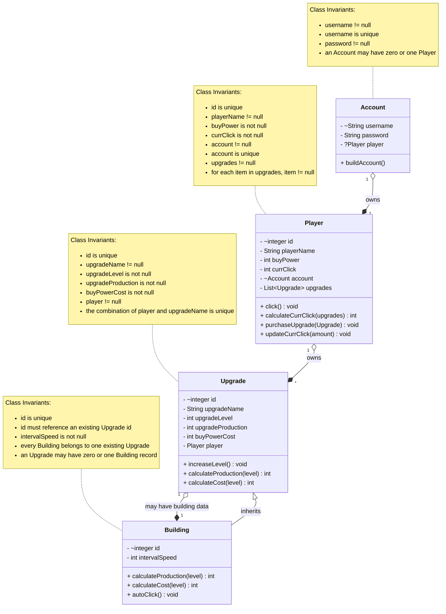

# Domain Model

## Changes since phase 1

* `Upgrade` became the superclass extended by `Building`.
* Removed the separate `Employer` and `FinancialAdvisor` classes because they are represented as instances of `Upgrade`.
* Added a unique ID to `Player`.
* Added a unique ID to `Upgrade`.
* Added a unique ID to `Building`.
* Added a one-to-zero-or-one relationship between `Upgrade` and `Building`.
* Each `Building` uses the ID of an existing `Upgrade`.
* A Player cannot have two Upgrades with the same `upgradeName`.
* `UpgradeType` is planned for later and is not currently part of the active data model.
