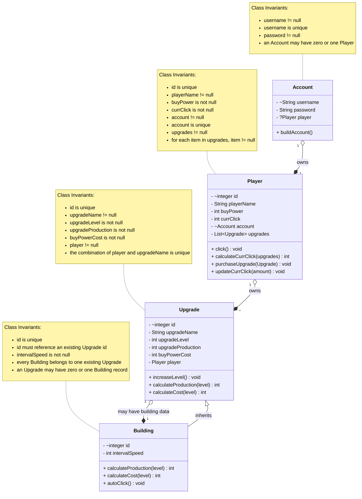

[//]: # (---)

[//]: # (title: Domain Model for my Money Clicker!)

[//]: # (author: Kate Nabo &#40;nabok@myumanitoba.ca&#41;)

[//]: # (date: Summer 2026)

[//]: # (---)

[//]: # (# Domain Model)

[//]: # ()
[//]: # (```mermaid)

[//]: # ()
[//]: # (classDiagram)

[//]: # ()
[//]: # (class Player {)

[//]: # (    - string name)

[//]: # (    - double currClick)

[//]: # (    - double clickBuyPower)

[//]: # (    - List~Upgrade~ upgrades)

[//]: # (    - List~Building~ buildings)

[//]: # (    - ~Account account)

[//]: # (    + click&#40;&#41; void)

[//]: # (    + calculateCurrClick&#40;upgrades&#41; double)

[//]: # (    + purchaseUpgrade&#40;Upgrade&#41; void)

[//]: # (    + updateCurrClick&#40;amount&#41; void)

[//]: # (    })

[//]: # (    note for Player "Class Invariants:)

[//]: # (    <ul>)

[//]: # (    <li>currClick>=1</li>)

[//]: # (    <li>clickBuyPower>=0</li>)

[//]: # (    <li>upgrades!=null</li>)

[//]: # (    <li>for each item in upgrades != null</li>)

[//]: # (    </ul>")

[//]: # ()
[//]: # (    class Account{)

[//]: # (        - ~String username)

[//]: # (        - String password)

[//]: # (        - ~Player player)

[//]: # (        + buildAccount&#40;&#41;)

[//]: # (        )
[//]: # (    })

[//]: # (    note for Account "Class Invariants:)

[//]: # (    <ul>)

[//]: # (    <li>username is not empty</li>)

[//]: # (    <li>password is not empty</li>)

[//]: # (    </ul>")

[//]: # (  )
[//]: # (     class Upgrade {)

[//]: # (         -~id integer)

[//]: # (         - Player player)

[//]: # (         - UpgradeType name)

[//]: # (         - int level)

[//]: # (         - double production)

[//]: # (         - double buyPowerCost)

[//]: # (         + increaseLevel&#40;&#41; void)

[//]: # (         + calculateProduction&#40;level&#41; double)

[//]: # (         + calculateCost&#40;level&#41; double)

[//]: # ()
[//]: # (     })

[//]: # (     class UpgradeType {)

[//]: # (        <<Enumeration>>)

[//]: # (         FinancialAdvisor)

[//]: # (         Employer)

[//]: # (         RoyalMint)

[//]: # (         Banker)

[//]: # ( })

[//]: # (    note for Upgrade "Class Invariants:)

[//]: # (    <ul>)

[//]: # (    <li>name!=null</li>)

[//]: # (    <li>level>=0</li>)

[//]: # (    <li>production>0</li>)

[//]: # (    <li>buyPowerCost>0</li>)

[//]: # (    </ul>")

[//]: # (    )
[//]: # (    )
[//]: # (    Player "1" o--* "*" Upgrade)

[//]: # (    Account "1" o--* "1" Player : account owns player)

[//]: # (%%    Player --> UpgradeType)

[//]: # (    Upgrade --* UpgradeType)

[//]: # (    Player "1" o--* "*" Building)

[//]: # (    Upgrade "1" o--* "1" Building: )

[//]: # (    )
[//]: # (    note for Building "Upgrade and Building Relationship Note:)

[//]: # (    <ul>)

[//]: # (    <li>Every building must use an existing ID so every existing Building belong to one upgrade,)

[//]: # (    <li> but an Upgrade may have no building or one building row)

[//]: # (    </ul>")

[//]: # (    )
[//]: # (%%    Upgrade "1" o--* "1" Building)

[//]: # (    )
[//]: # (    )
[//]: # (    class Building{)

[//]: # (        - ~id integer)

[//]: # (        - Player player)

[//]: # (        - intervalSpeed double)

[//]: # (        + calculateProduction&#40;level&#41; * double )

[//]: # (        + calculateCost&#40;level&#41; * double)

[//]: # (        + autoClick&#40;&#41; void)

[//]: # ( })

[//]: # (    Upgrade<|-- Building : inherits)

[//]: # (%%    Building--|> Upgrade)

[//]: # (    note for Building "Class Invariants:)

[//]: # (    <ul>)

[//]: # (    <li>intervalSpeed>=1</li>)

[//]: # (    </ul>")

[//]: # ()
[//]: # (````)

[//]: # ()
[//]: # ()
[//]: # ()
[//]: # (## Changes since phase 1)

[//]: # (* Upgrades class becomes the superclass which is extended by the Buildings class)

[//]: # (* Deleted the Employer and FinancialAdvisor classes as they will just be both instances of Upgrades. )

[//]: # (* All types of upgrades/buildings are in the enum called UpgradeType)

[//]: # (* username field in Account must be unique so constraints are added)

[//]: # (* id field in Upgrades must be unique so constraints are added)

[//]: # (* id field in Buildings must be unique so constraints are added)

[//]: # ()
[//]: # ()
---
title: Domain Model for my Money Clicker!
author: Kate Nabo (nabok@myumanitoba.ca)
date: Summer 2026
---

# Domain Model



## Changes since phase 1

* `Upgrade` became the superclass extended by `Building`.
* Removed the separate `Employer` and `FinancialAdvisor` classes because they are represented as instances of `Upgrade`.
* Added a unique ID to `Player`.
* Added a unique ID to `Upgrade`.
* Added a unique ID to `Building`.
* Added a one-to-zero-or-one relationship between `Upgrade` and `Building`.
* Each `Building` uses the ID of an existing `Upgrade`.
* A Player cannot have two Upgrades with the same `upgradeName`.
* `UpgradeType` is planned for later and is not currently part of the active data model.
