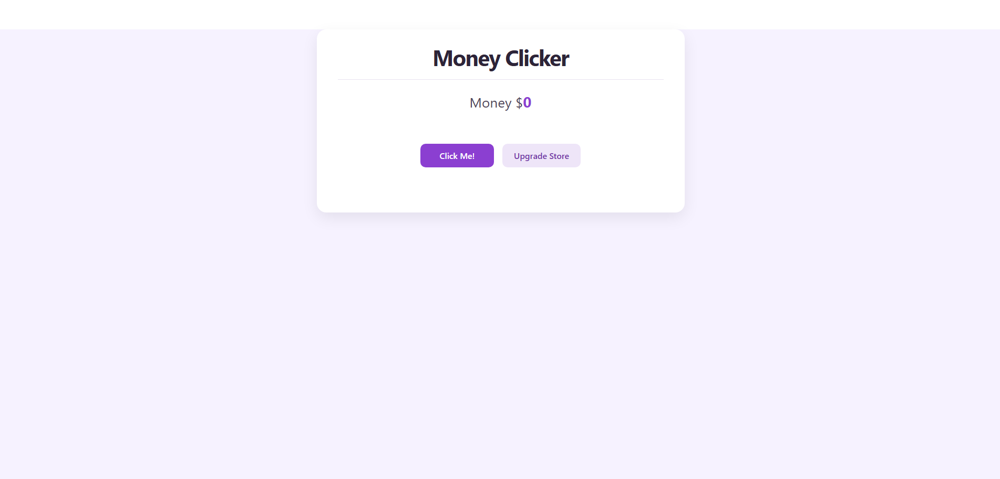
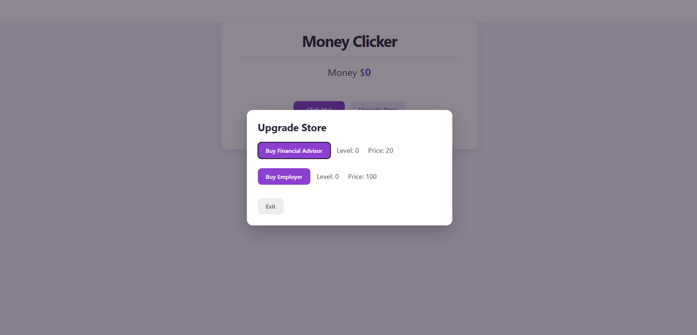
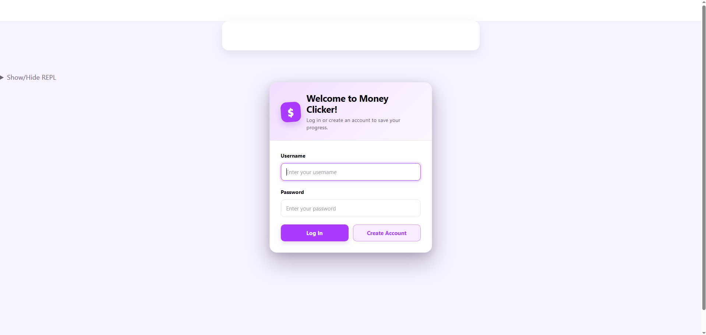
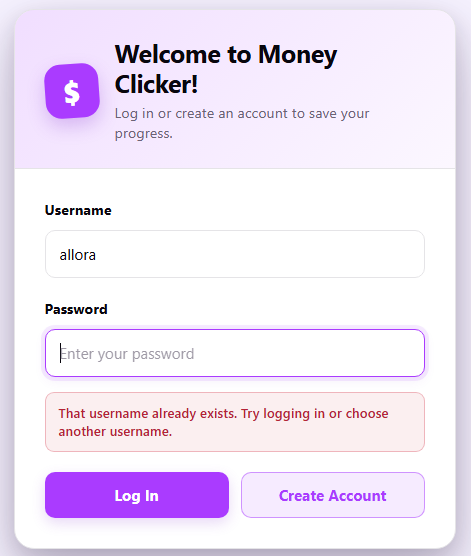
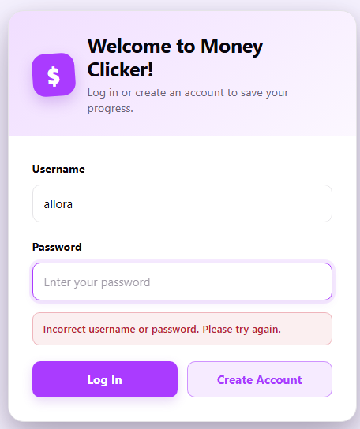
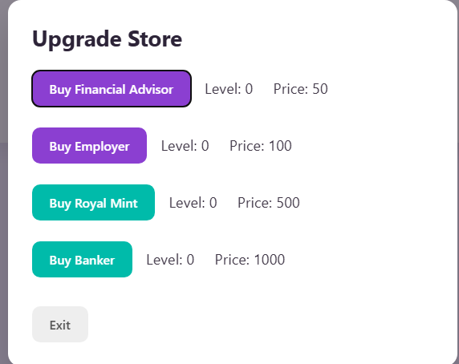
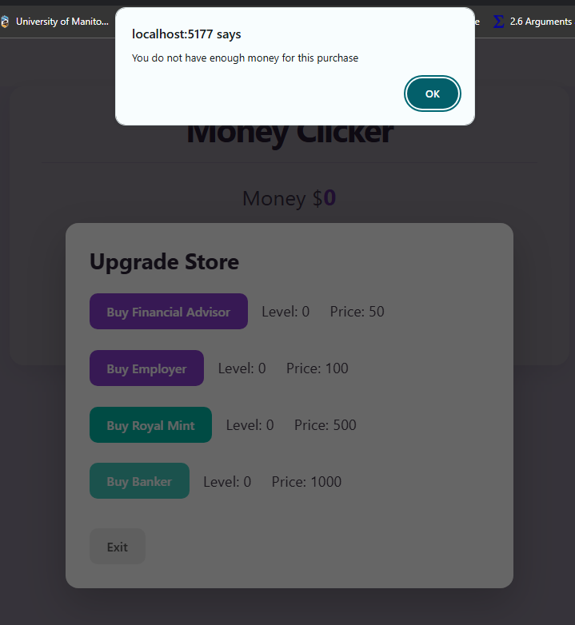

---
 Phase 1 User Interface: 
---

---

## Phase 1 Visibility
The first implementation of this UI was minimally visible because:

* :-1: It doesn't tell the user what state they're in. The user just starts in the main page with no
indication whether the game has started or not. It doesn't tell them that clicking `click me` for the first
time is what will essentially start the game

* :-1: Purchase buttons remain active even when the user does not have enough money.
* The buttons could be visibly disabled until the user can afford the item.

* :-1: The store does not explain what each upgrade does. The user can see the name and price 
* but cannot see how much it increases their money power 

* :+1: Possible actions such as `click me` and `upgrade store` are visible at all times
* and clicking the upgrade store will show the user the available upgrades they can buy

## Phase 1 Feedback
The first implementation of this UI had minimal feedback because:
* :-1: Attempting to purchase an upgrade with not enough money does not inform the user that they cannot purchase it 
* due to an insufficient amount of money

* :-1: It also does not communicate to the user any ways to fix the error. So informing the user the first point above
* and also letting them know that clicking the `click me` button more will allow to them to eventually buy the upgrade

* :-1: A successful purchase does not make it fully obsiouy that the user successfully purchased the upgrade
* the decrease in their money might not be the most visible but the level increases and new price is displayed
* :+1: Every time the user clicks the `click me` button, the money goes up by 1, and more if they have upgrades.

## Phase 1 Consistency
The first implementation of this UI had good consistency because:
* :+1: All buttons in the app had appropriate labels with verbs

* :+1: It has a clear flow, which is click the click me button or open the store to purchase upgrades.
* The main page, upgrade store, the rounded corner buttons, and purple theme are consistent in all flows. 

* :-1: My money in the main page had a $ sign but the store prices do not which would have helped with clarity
``
## Changes from phase 1
- The main change I made from phase 1 to phase 2 was implementing a UI for login system and adding extra buttons for purchasing
- the buildings upgrades

---

Phase 2 User Interface:
---

## Phase 2 Visibility
The second implementation of this UI has adequate visibility because:
* :+1: The login screen clearly shows the actions available to the user.
They can either `Log In` or `Create Account`, and both input fields have visible labels.

* :+1: The message under the heading explains that users must log in or create an account to save their progress
helping them understand the current stage of the application

* :-1: Purchase buttons remain enabled when the user does not have enough money
The buttons could be visibly disabled until the user can afford the item

* *:-1: It still does not explain what each upgrade/building does. It also still does not tell the user how much each
upgrade/building increases their money

## Phase 2 Feedback
The second implementation of this UI has good feedback because:
* :+1: The currently selected input field is highlighted with a purple border, informing the user which field they are typing into

* :+1: Attempting to create an account with an existing username displays a clear error
message explaining what went wrong and suggests logging in or choosing another username.

* :+1: Entering incorrect login information displays a clear message telling the user that the
username or password is incorrect and that they should try again

* :-1: The insufficient-money error uses a browser alert, while the account errors appear as messages inside the application. 
Displaying a message inside the store would provide clearer and less disruptive feedback

* :-1: The insufficient money message does not explain exactly how much more money is required or how the user can fix the problem

## Phase 2 Consistency
The second implementation of this UI had good consistency because:
* :+1: All buttons are clear and used verbs like `Log In`, `Create Account`, `Buy Financial Advisor`,  `Buy Banker`.

* :+1: The login page, main game page, and upgrade store use similar fonts, rounded corners, shadows, and a consistent purple theme

* :+1: Similar purchasing operations follow the same flow. Each store item displays a purchase button followed by its level and price.

* :+1: Regular upgrades consistently use purple buttons, while buildings consistently use teal buttons, making the two categories visually 
distinguishable but the buildings can feel out of place since the app has a purple theme. 

* :+1: The username and password fields both have visible labels and use the same input style.
* :-1: Error messages are not presented consistently. Login and account creation errors are shown inside the interface, 
but the insufficient money error uses a browser alert
* :-1: The store prices remained missing the $ sign for prices

* :-1: The purchase buttons have different widths depending on the length of their labels.
Consistently sized buttons or aligned columns would make the store easier to scan

